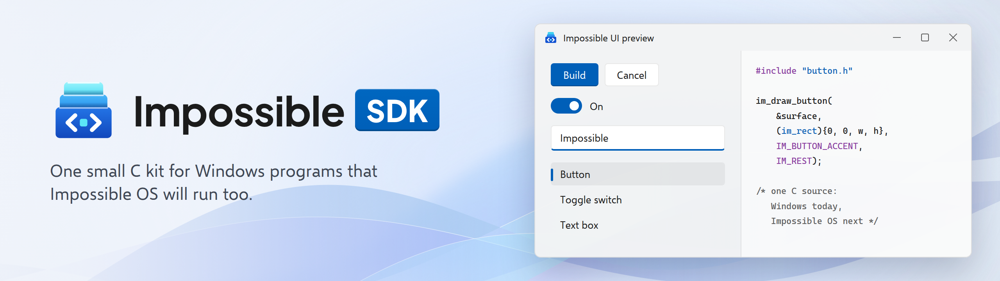
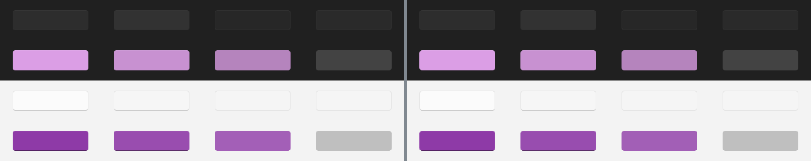
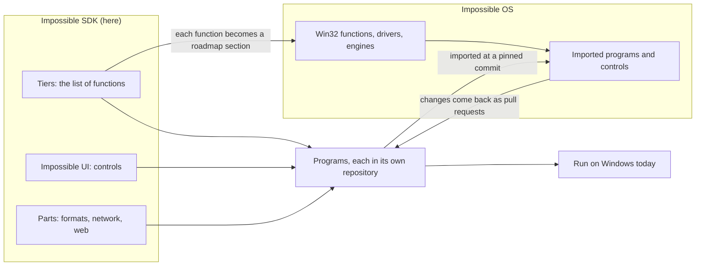
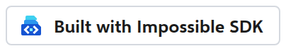

<div align="center">

<picture>
  <source media="(prefers-color-scheme: dark)" srcset="brand/banner-dark.png">
  <source media="(prefers-color-scheme: light)" srcset="brand/banner-light.png">
  
</picture>

<br>
<br>

[](https://github.com/rizonesoft/ImpossibleSDK/actions/workflows/build.yml)
[](LICENSE)
[](include/impossible/base.h)
[](abi/tiers.json)
[](https://github.com/rizonesoft/impossible-os)

[Documentation](https://sdk.impossibleos.co/docs/) · [sdk.impossibleos.co](https://sdk.impossibleos.co/) · [Impossible OS](https://impossibleos.co/) · [Roadmap](todo/implementation-plan.md) · [Contributing](CONTRIBUTING.md) · [Discussions](https://github.com/rizonesoft/ImpossibleSDK/discussions)

</div>

Impossible SDK is the C kit that the programs of [Impossible OS](https://github.com/rizonesoft/impossible-os) are built with. A program is an ordinary 64-bit Windows executable with no C runtime. It paints its own pixels and calls only the Windows functions on one published list. Impossible OS is building that same list, so that one program runs on both.

> [!NOTE]
> **Status: early, no release yet.** Programs run on Windows today. They do not run on Impossible OS yet: it is building the functions they call ([what programs need](https://github.com/rizonesoft/impossible-os/blob/main/todo/10-platform-services/TODO-13-program-needs.md)).

## Contents

- [Why another SDK?](#why-another-sdk)
- [What works today?](#what-works-today)
- [Quick start](#quick-start)
- [A whole program](#a-whole-program)
- [Tiers: which Windows functions may a program call?](#tiers-which-windows-functions-may-a-program-call)
- [Impossible UI](#impossible-ui)
- [How does it work with Impossible OS?](#how-does-it-work-with-impossible-os)
- [Repository layout](#repository-layout)
- [FAQ](#faq)
- [Contributing](#contributing)
- [License](#license)

## Why another SDK?

<!-- site:small -->

- **Small.** The console sample is 3 KB and the window sample 73 KB, with nothing beside them to install.

<!-- /site:small -->
- **A list, not a promise.** Every function a program may call is in [`abi/tiers.json`](abi/tiers.json). The build reads the finished program's imports and fails on anything else.
- **One source, two systems.** Windows first, Impossible OS next. A program never asks which one it is on.
- **Windows 11's look, from its source.** Control values come from WinUI 3's MIT source at a pinned commit, and the drawing is compared with the real thing.
- **Proved, not assumed.** Programs built in WSL are run by Windows itself before they count.

## What works today?

Legend: ✅ works · 🚧 in progress · 📋 planned

<!-- site:status -->

| Area | Status | What you get |
| --- | :---: | --- |
| Start-up, memory, text, files, console | ✅ | [`base.h`](include/impossible/base.h), [`text.h`](include/impossible/text.h), [`file.h`](include/impossible/file.h): UTF-8 everywhere, safe file replacement |
| One window | ✅ | [`window.h`](include/impossible/window.h): a canvas of pixels, pointer, keys and DPI |
| Import check | ✅ | [`check_imports.py`](tools/check_imports.py), run on every program |
| Pinned toolchain | ✅ | llvm-mingw, CMake and Ninja by version and hash, the same on Windows and WSL |
| Impossible UI: drawing, theme, button | ✅ | Light, dark and contrast values, smooth corners, the button, [compared with real WinUI](tests/test_ui.py) |
| Impossible UI: engine and text | 🚧 | [Interface engine](todo/01-interface/TODO-01-first-controls.md) and [text engine](todo/01-interface/TODO-02-text.md) |
| Impossible UI: controls and dialogs | 📋 | [Controls](todo/05-controls/TODO-01-controls.md), [more controls](todo/05-controls/TODO-02-more-controls.md) and [dialogs](todo/05-controls/TODO-03-dialogs.md) |
| Picture formats, shared parts | 🚧 | [Formats](todo/02-formats/TODO-01-image-formats.md) and [shared parts](todo/06-shared/TODO-01-shared-parts.md) |
| Network: TLS, HTTP, kept secrets | 📋 | [Network](todo/03-network/TODO-01-network.md) |
| Web readers: HTML and CSS | 📋 | [Web](todo/04-web/TODO-01-web-readers.md) |
| Clipboard, input methods, screen readers, sound, settings | 📋 | [Windows services](todo/07-windows/TODO-01-windows-services.md) |
| Printing | 📋 | [Printing](todo/07-windows/TODO-02-printing.md) |
| Installer, first release | 📋 | [Parts and release](todo/08-release/TODO-01-parts-and-release.md) |

<!-- /site:status -->

## Quick start

Windows or WSL on 64-bit x86, with Python 3.12 or newer. In WSL the command is `python3`.

<!-- site:start -->

```
git clone https://github.com/rizonesoft/ImpossibleSDK.git SDK
cd SDK
python tools/bootstrap.py    # installs the pinned toolchain, once per machine
python tools/build.py        # builds into build/<host> and runs the tests
```

<!-- /site:start -->

On plain Linux the programs build, and the tests that run them are skipped.

## A whole program

<!-- site:hello -->

```c
#include <impossible/base.h>

int im_main(void) {
    return im_print("Hello from Impossible SDK\n") ? 0 : 1;
}
```

<!-- /site:hello -->

<!-- site:cmake -->

```cmake
cmake_minimum_required(VERSION 4.0)
project(Hello LANGUAGES C)
include("${IMPOSSIBLE_SDK_DIR}/cmake/ImpossibleSDK.cmake")
impossible_add_program(Hello CONSOLE TIER 0 SOURCES src/main.c)
```

<!-- /site:cmake -->

Start a program's own repository, pinned to this SDK's commit, with [`tools/new_app.py`](tools/new_app.py):

```
python tools/new_app.py ../Hello --label Hello --tier 1 --window --license gpl-3.0.txt
python tools/app_build.py ../Hello
```

More in [`samples/`](samples).

## Tiers: which Windows functions may a program call?

A program names the highest tier it needs; each tier includes the ones before it.

<!-- site:tiers -->

| Tier | Name | Adds |
| :-: | --- | --- |
| 0 | Console | Files, memory, time, threads |
| 1 | Window | One window, input, and one call that shows a bitmap |
| 2 | Documents | Clipboard, drag and drop, file watching, starting programs |
| 3 | Media | Sound out and in |
| 4 | Network | Sockets, secure random numbers, protected passwords |
| 5 | Desktop | Seeing and driving other windows, and devices |

<!-- /site:tiers -->

Imports by ordinal, delay-loaded DLLs, bound imports and thread-local storage are refused. The list grows only on purpose: each new function becomes a section of the Impossible OS roadmap.

## Impossible UI

The controls of Windows 11, drawn in portable C: no system call, no floating point, no C library. It builds with a kernel's flags as well as a program's.



*Left: drawn by Impossible UI. Right: drawn by real WinUI 3 on Windows. The [tests](tests/test_ui.py) compare the two pixel by pixel: straight edges and fills may differ by rounding only, and corners have their own limit.*

Values are generated from [microsoft-ui-xaml](https://github.com/microsoft/microsoft-ui-xaml) (MIT, [notice](licenses/WinUI.txt)) at the commit in [`tools/winui/pin.json`](tools/winui/pin.json). No Microsoft font, icon, picture, sound or wording is used.

## How does it work with Impossible OS?



- **The OS owns** its kernel, drivers, engines and every Windows function, and the [Windows 11 inventory](https://github.com/rizonesoft/impossible-os/tree/main/docs/design/inventory) both sides measure against.
- **The SDK owns** the controls, the shared parts and the list of functions.
- **Neither waits for the other.** The OS keeps the ledger of what it takes from here: [imported programs and parts](https://github.com/rizonesoft/impossible-os/blob/main/todo/11-apps/TODO-15-imported-programs.md).

| Repository | What it is |
| --- | --- |
| [Impossible OS](https://github.com/rizonesoft/impossible-os) | The 64-bit operating system these programs are made for |
| [Command](https://github.com/rizonesoft/Command) | Command line tools, built with this SDK |
| [Heliograph](https://github.com/rizonesoft/Heliograph) | Messages between sessions on one machine, built with this SDK |

More programs are on the way, from Notepad and Calculator to a browser with its own engine. Each is published with its first working version.

<a href="brand/README.md"><picture><source media="(prefers-color-scheme: dark)" srcset="brand/badge-dark.png"></picture></a>

## Repository layout

| Path | Contents |
| --- | --- |
| `abi/` | The tiers: every Windows function a program may call |
| `include/`, `src/` | The kit: headers, and the Windows layer |
| `ui/` | Impossible UI |
| `samples/` | The smallest console and window programs |
| `tools/` | Toolchain, build, import check, proof on Windows, new programs, [contributing from a program](tools/contribute.py) |
| `reference/` | The WinUI program the drawing is compared with |
| `site/`, `docs/guide/` | [sdk.impossibleos.co](https://sdk.impossibleos.co/): its frame and written pages; the rest is generated |
| `tests/` | What must stay true |
| `brand/` | The identity and its sources |
| `todo/`, `docs/` | The work list, the [design](docs/specs/2026-11-23-interface-and-apps-design.md), and how it is worked on |

## FAQ

<details>
<summary><strong>Is it a C runtime?</strong></summary>

No. It has the few things a program needs to start, use memory, text and files, and open a window. `printf` is not one of them.

</details>

<details>
<summary><strong>Why not just use the Windows SDK?</strong></summary>

You can, on Windows. A program for both systems needs a short list of functions that a new operating system can really provide, and a build that holds it to that list.

</details>

<details>
<summary><strong>Can I use it for a closed program?</strong></summary>

Yes. It is MIT. Impossible OS itself and the programs of its project are GPL-3.0-only.

</details>

<details>
<summary><strong>WSL cannot start a Windows program sometimes?</strong></summary>

`UtilAcceptVsock ... accept4 failed` means the Linux kernel found no unbroken 512 KB of memory for the connection (`dmesg` shows `page allocation failure: order:7`). Set `vm.min_free_kbytes = 262144` and `vm.compaction_proactiveness = 60` in `/etc/sysctl.d/`. The tests report it and do not hide it.

</details>

## Contributing

Start with [CONTRIBUTING.md](CONTRIBUTING.md). Report a security problem privately as [SECURITY.md](SECURITY.md) says, and follow the [code of conduct](CODE_OF_CONDUCT.md).

## License

MIT. See [LICENSE](LICENSE). Values from WinUI keep [their notice](licenses/WinUI.txt).

<div align="center">
<sub>Made in the open by <a href="https://rizonetech.com">Rizonetech (Pty) Ltd</a> · part of <a href="https://impossibleos.co/">Impossible OS</a></sub>
</div>
